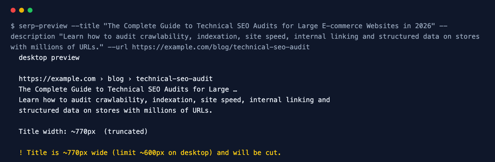

<div align="center">

# SERP Preview

**See exactly where Google will cut your title and description — in pixels, not characters.**

[](https://github.com/ksanyok/serp-preview/actions/workflows/ci.yml) [](LICENSE)   [](https://promopilot.link/en/tools/serp-preview.php?utm_source=github&utm_medium=repo&utm_campaign=tools&utm_content=serp-preview)

**[▶ Use the free online version — no install, no sign-up](https://promopilot.link/en/tools/serp-preview.php?utm_source=github&utm_medium=repo&utm_campaign=tools&utm_content=serp-preview)**

</div>

`serp-preview` shows how a page will look in Google's results. Google truncates titles and descriptions by **pixel width**, not character count — a title full of `W` and `M` is cut much earlier than one full of `i` and `l`. This tool measures text with the real Arial glyph widths Google renders with, finds the exact truncation point on desktop and mobile, and prints the snippet the way searchers will see it. Give it a URL, or test a title before the page exists.



## What it checks

- Title width in pixels at Google's 20 px Arial (desktop) and 18 px (mobile), with the exact cut point
- Description width at 14 px against the ~2-line desktop limit and the longer mobile snippet
- Truncation at a word boundary with `…`, like the real result page
- Empty titles, generic titles (`Home`, `Untitled`), all-caps titles that Google tends to rewrite
- Missing descriptions (Google then picks text from the page) and very short ones
- The breadcrumb-style URL line shown above the title

## Why it matters

The title is the headline of your search result and the strongest factor in whether people click. When it is cut off, the part that gets lost is usually the end — the benefit, the year, the brand. Character limits like "60 characters" are only a rough guess, because Google measures pixels: `WWW` takes more than twice the space of `iii`. Measuring in pixels lets you write the longest title that still fits, and check every template before it ships.

## Quick start

```bash
# run straight from GitHub, nothing to install
npx github:ksanyok/serp-preview example.com

# or install the CLI globally
npm install -g github:ksanyok/serp-preview
serp-preview example.com
```

Test a title and description before publishing:

```bash
serp-preview --title "Blue Widgets for Small Workshops | Example" --description "Compare 40 blue widgets by size, price and durability." --url https://example.com/widgets
```

Mobile limits:

```bash
serp-preview example.com/blog/post --mobile
```

Save a visual preview:

```bash
serp-preview example.com --html preview.html
```

## Example output

```text
$ serp-preview --title The Complete Guide to Technical SEO Audits for Large E-commerce Websites in 2026 --description Learn how to audit crawlability, indexation, site speed, internal linking and structured data on stores with millions of URLs, with checklists, tools and real examples. --url https://example.com/blog/technical-seo-audit
  desktop preview

  https://example.com › blog › technical-seo-audit
  The Complete Guide to Technical SEO Audits for Large …
  Learn how to audit crawlability, indexation, site speed, internal linking and
  structured data on stores with millions of URLs, with checklists, tools and real
  …

  Title width: ~770px  (truncated)

  ! Title is ~770px wide (limit ~600px on desktop) and will be cut.
  ! Description is ~1005px (about 168 characters) and will be cut.
```

## CLI

```text
Usage: serp-preview <url> [options]
       serp-preview --title "Page title" --description "Meta description" [--url URL]

Shows how a title and meta description will look in Google search results,
measured in pixels (Arial) rather than characters, with the truncation point.

Options:
  --title <text>        Title to preview (instead of fetching a URL)
  --description <text>  Meta description to preview
  --url <url>           URL shown above the title
  --mobile              Use mobile limits
  --html <file>         Also write an HTML file with a visual preview
  --json                Print JSON
  --strict              Exit with code 1 on warnings too
  -h, --help            Show this help

Online version (no install): https://promopilot.link/en/tools/serp-preview.php
```

## Use as a library

```js
import { serpPreview, previewUrl, textWidth, truncateToWidth } from '@promopilot/serp-preview';

const p = serpPreview({ title: 'Blue Widgets for Small Workshops', description: '…', url: 'https://example.com/widgets' });
console.log(p.title, p.titleWidth, p.titleTruncated, p.issues);

await previewUrl('https://example.com/', { device: 'mobile' });
textWidth('Hello world', 20);            // pixels at 20px Arial
truncateToWidth('A long title …', 600, 20); // { text, truncated, width }
```

`serpPreview({ title, description, url }, device)` returns `{ device, url, title, titleTruncated, titleWidth, description, descriptionTruncated, issues[] }`. Use it in a CMS or a test suite to validate every page template. Issue codes are stable: `title-missing`, `title-truncated`, `title-short`, `title-generic`, `title-caps`, `description-missing`, `description-truncated`, `description-short`.

## Use in CI (GitHub Actions)

Check the title of a key page after each deploy:

```yaml
on: [deployment_status]
jobs:
  snippet:
    runs-on: ubuntu-latest
    steps:
      - uses: ksanyok/serp-preview@v1
        with:
          args: https://example.com/ --strict
```

## How it works

Every character's advance width is taken from the Arial font metrics (in 1/1000 em) for ASCII, with calibrated estimates for Cyrillic, wide CJK characters, emoji and typographic punctuation, and multiplied by the font size Google uses. Text that is wider than the limit is cut character by character until it fits together with ` …`, then moved back to the last word boundary. The limits (about 600 px for a desktop title and roughly two lines for a description) are approximations of the current layout — Google changes its design from time to time, so treat results as a close estimate rather than a guarantee.

## CLI vs. online version

| | This package | [Online tool](https://promopilot.link/en/tools/serp-preview.php?utm_source=github&utm_medium=repo&utm_campaign=tools&utm_content=serp-preview) |
|---|---|---|
| Runs on | Your machine, CI, CMS hooks | Any browser |
| Input | URL or raw text | URL or raw text |
| Preview | Text, HTML file | Live visual preview while typing |
| Output | Text, JSON, exit codes | Visual |
| Price | Free, MIT | Free, no sign-up |


## FAQ

<details>
<summary><b>Why pixels instead of characters?</b></summary>

Google's result titles have a fixed width. Narrow letters fit more, wide letters fewer, so a 55-character title can be cut while a 65-character one fits. Pixel width is what actually decides.
</details>

<details>
<summary><b>Will Google always show my title and description?</b></summary>

No. Google rewrites titles and picks its own snippet when it thinks they match the query better. A title that fits, describes the page accurately and is not stuffed with keywords is rewritten far less often.
</details>

<details>
<summary><b>How long should a meta description be?</b></summary>

About 120–160 characters on desktop. Mobile can show a little more. Put the key message in the first 120 characters.
</details>

<details>
<summary><b>Are the limits exact?</b></summary>

They are close approximations. Google's layout and fonts vary by device, language and experiment; the tool errs on the safe side.
</details>

<details>
<summary><b>Does it support non-Latin scripts?</b></summary>

Yes, with estimated widths for Cyrillic, CJK and emoji. Results for Latin text are the most precise.
</details>

<details>
<summary><b>Is there a version without installing anything?</b></summary>

Yes — the [online SERP Preview](https://promopilot.link/en/tools/serp-preview.php?utm_source=github&utm_medium=repo&utm_campaign=tools&utm_content=serp-preview) runs the same checks in the browser and explains each result.
</details>

## Related free tools

- [Meta Tag Analyzer](https://promopilot.link/en/tools/meta-analyzer.php?utm_source=github&utm_medium=repo&utm_campaign=tools&utm_content=meta-analyzer) — title, description, canonical, robots and Open Graph
- [Open Graph Debugger](https://promopilot.link/en/tools/og-debugger.php?utm_source=github&utm_medium=repo&utm_campaign=tools&utm_content=og-debugger) — preview and validate social sharing tags
- [Keyword Density Checker](https://promopilot.link/en/tools/keyword-density.php?utm_source=github&utm_medium=repo&utm_campaign=tools&utm_content=keyword-density) — word and phrase frequency of a page
- [Schema Validator](https://promopilot.link/en/tools/schema-validator.php?utm_source=github&utm_medium=repo&utm_campaign=tools&utm_content=schema-validator) — check JSON-LD structured data
- [UTM Builder](https://promopilot.link/en/tools/utm-builder.php?utm_source=github&utm_medium=repo&utm_campaign=tools&utm_content=utm-builder) — tag campaign links consistently
- [All 120+ free SEO, email and web tools](https://promopilot.link/en/tools/?utm_source=github&utm_medium=repo&utm_campaign=tools&utm_content=serp-preview)

## Contributing

Bug reports and pull requests are welcome — see [CONTRIBUTING.md](CONTRIBUTING.md). Security issues: [SECURITY.md](SECURITY.md).
More docs live in the [wiki](https://github.com/ksanyok/serp-preview/wiki) (sources in [docs/wiki](docs/wiki)).

## License

[MIT](LICENSE) © 2026 Alexandr Krikun

---

<sub>Built and maintained by the team behind [PromoPilot](https://promopilot.link/?utm_source=github&utm_medium=repo&utm_campaign=tools&utm_content=serp-preview) — link building, SEO monitoring and 120+ free tools for site owners. Also on [YouTube](https://www.youtube.com/channel/UCPB8m7BgaexcZh0Vr49ViYA).</sub>
